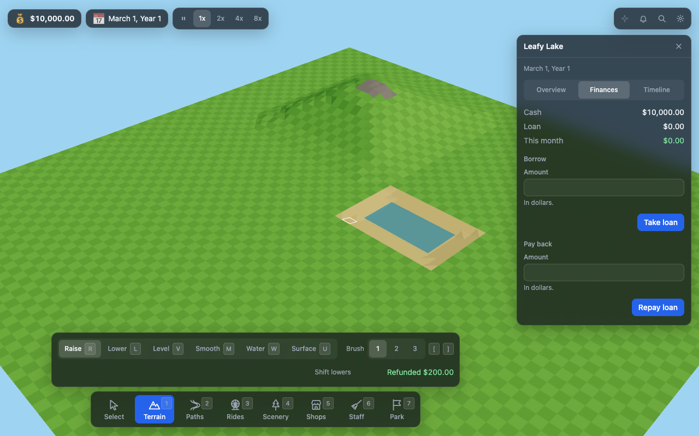

# Coasterworks

Coasterworks is an open-source theme-park builder in the spirit of RollerCoaster Tycoon: the depth of the original with a UI built for 2026, playable without any original game files, and MCP native so Claude or any agent can build and run a park through the same commands the player uses. Mac first; other platforms later.

Status: pre-alpha. You can fly around a park and shape terrain in the browser (`pnpm dev:web`) or the Mac app (`pnpm dev:desktop`). Rides, guests and money arrive in the next plans.



## Run it in the browser

You need Node 22 or newer and pnpm 10 or newer.

```bash
pnpm install
pnpm dev:web
```

Open `http://localhost:5173`. The page runs a sample park, "Leafy Lake", in a worker of its own. The dock along the bottom has seven tools (keys `1` to `7`), and Terrain's tray shapes the land: Raise, Lower, Level, Smooth, Water and Surface (keys `R`, `L`, `V`, `M`, `W`, `U`; `[` and `]` change the brush). `Esc` puts the tool down, Space pauses, `+` and `-` change the speed, and Cmd+Z undoes.

## Run the Mac app (dev)

The Mac app is a Tauri 2 window around the same page, with the park kept on disk and an MCP endpoint that agents can use while you play. It needs:

- Rust, installed with [`rustup`](https://rustup.rs)
- Node 22 or newer
- pnpm 10 or newer

```bash
pnpm install && pnpm build && pnpm dev:desktop
```

The first compile takes a few minutes; after that it is seconds. The app stores its park at `~/Library/Application Support/com.coasterworks.app/parks/current.park` and stops its sidecar when you close the window. See [apps/desktop/README.md](apps/desktop/README.md) for how it works.

## Connect Claude to the running app

The running Mac app serves MCP on a port and with a token that change on every launch. Choose **File > Copy MCP Config**, then paste what it copied into your project's `.mcp.json`. The token in it is a secret, so keep that file out of version control. Or take the `url` and the token from the same config and register them with Claude Code:

```bash
claude mcp add --transport http coasterworks <mcpUrl> --header "Authorization: Bearer <token>"
```

Whatever Claude builds shows up in the window as it happens.

## Try it headless

The simulation also runs without a window, from the command line, which is how scripts, tests and agents drive it. You need Node 22 or newer and pnpm 10 or newer.

```bash
pnpm install
pnpm build
```

Make a park, change it, let time pass, and look at it. Every command prints one line of JSON, and `run` and `exec` leave the file alone unless you give `--out`; `query` never changes it, and `undo` and `redo` always need `--out`.

```bash
# Create a 64 by 64 park in my.park (add --force to replace a file that is already there)
node apps/cli/dist/index.js new --out my.park --name "Demo Park" --seed 1

# Or start from the sample park, Leafy Lake, with a hill and a pond (the Mac app's first run)
node apps/cli/dist/index.js new --out leafy.park --sample --seed 1

# Raise a patch of land (the result says what it cost, in cents)
node apps/cli/dist/index.js exec --save my.park --command terrain_raise --input '{"x":4,"y":4,"w":3,"h":3}' --out my.park

# Let 30 days pass
node apps/cli/dist/index.js run --save my.park --days 30 --out my.park

# Show the park's status and its recent command log
node apps/cli/dist/index.js inspect my.park

# Ask a read-only question (the result is {"ok":true,"result":...}); the file is never touched
node apps/cli/dist/index.js query --save my.park --name park_status
node apps/cli/dist/index.js query --save my.park --name terrain_get --input '{"x":0,"y":0,"w":4,"h":4}'

# Take back the last command, then do it again (both need --out)
node apps/cli/dist/index.js undo --save my.park --out my.park
node apps/cli/dist/index.js redo --save my.park --out my.park
```

Command names such as `terrain_raise` come from `packages/sim/src/commands`, and query names such as `park_status` and `terrain_get` from `packages/sim/src/queries`. A failed command or query exits 1 and still prints its result.

## Connect Claude Code

The same commands are available to an agent over MCP. Build first (`pnpm build`), then register the server with Claude Code, using absolute paths:

```bash
claude mcp add coasterworks -- node /absolute/path/to/apps/cli/dist/index.js mcp --save /absolute/path/my.park --out /absolute/path/my.park
```

Claude can then build in the park with the tools the sim exposes (`terrain_raise`, `park_status`, `undo`, and so on). `--out` writes every change back to the file; without it the park lives in memory and `--save` is never modified.

For a client that cannot start a process, serve it over HTTP instead:

```bash
node /absolute/path/to/apps/cli/dist/index.js mcp --save /absolute/path/my.park --out /absolute/path/my.park --http 7788 --token <a-secret-you-choose>
```

The server listens on `127.0.0.1` and wants `Authorization: Bearer <token>` on every request, with a `Host` header that names the local machine (`127.0.0.1` or `localhost`), so a web page cannot reach it through a rebound DNS name. To keep the token out of your process list, leave out `--token` and set `COASTERWORKS_MCP_TOKEN` instead. If you give neither, the server makes a random token and prints it with the URL, as `{"url":...,"port":...,"token":...}`. Over HTTP the `save_write` and `save_load` file tools are off, because they let any holder of the token read and write files as you. Turn them on with `--allow-files` only if you trust every client; even then they only touch paths that end in `.park`.

Configuration for an MCP client that speaks Streamable HTTP, such as a project's `.mcp.json`. Claude Code expands environment variables in `.mcp.json`, so the file names `COASTERWORKS_MCP_TOKEN` and should not hold a literal token (it is usually committed):

```json
{
  "mcpServers": {
    "coasterworks": {
      "type": "http",
      "url": "http://127.0.0.1:7788/mcp",
      "headers": { "Authorization": "Bearer ${COASTERWORKS_MCP_TOKEN}" }
    }
  }
}
```

### Run the sidecar

`serve` hosts the park for the desktop app: a WebSocket at `/ws` for the window and the MCP endpoint at `/mcp` for agents, on one port, with the clock running. What an agent builds shows up in the window as it happens, and `--out` saves the park whenever a command changes it and once more on the way out.

```bash
node /absolute/path/to/apps/cli/dist/index.js serve --save /absolute/path/my.park --out /absolute/path/my.park --token <a-secret-you-choose>
```

It prints one line of JSON once it is listening, `{"wsUrl":"ws://127.0.0.1:<port>/ws","mcpUrl":"http://127.0.0.1:<port>/mcp","port":<port>,"token":"<token>"}`, and runs until Ctrl-C. The token comes from `--token`, `COASTERWORKS_MCP_TOKEN`, or a random one made for you, as for `mcp --http`; agents send it as a bearer token to `mcpUrl`, and the window passes it as `?token=<token>` on `wsUrl`. `--port` (default `0`, any free port), `--host` (default `127.0.0.1`), `--speed` (`0`, `1`, `2`, `4` or `8`; default `1`), `--allow-files` and `--exit-on-stdin-eof` (stop, saving as Ctrl-C does, when stdin ends, so a program that started `serve` and then dies does not leave it running; the desktop app passes it) are the other options, and `GET /health` answers `{"ok":true,"name":...,"tick":...}`.

To point the web app at the sidecar, start it with `pnpm dev:web` and open `http://localhost:5173/?ws=<wsUrl>&token=<token>`.

## What's here

- `packages/sim`: the deterministic simulation core: world, commands, queries, undo, and the save format (`@coasterworks/sim`)
- `packages/mcp`: the MCP server that exposes sim commands to agents over stdio and HTTP (`@coasterworks/mcp`)
- `packages/protocol`: the wire between a running sim and its clients: messages, binary snapshots, `SimHostServer` and `SimClient` (`@coasterworks/protocol`)
- `packages/render`: the three.js terrain renderer, camera and picking, with no React in it (`@coasterworks/render`)
- `apps/cli`: the `coasterworks` command line app: `new`, `run`, `inspect`, `exec`, `query`, `undo`, `redo`, `mcp`, and `serve`
- `apps/web`: the browser client, built with Vite and React: the park view, status pills, speed control and terrain tools (`@coasterworks/web`)
- `apps/desktop`: the Mac app, a Tauri 2 shell that starts the `serve` sidecar and opens the web client (`@coasterworks/desktop`)

## Determinism

The simulation uses integer math only and draws all its randomness from a seeded generator, so the same seed and the same command log always produce the same park. CI runs a golden scenario on Linux and macOS (Node) and again on JavaScriptCore (Bun), and requires all of them to end on the same recorded hash.

## Development

```bash
pnpm install
pnpm typecheck
pnpm build
pnpm test
pnpm format:check
pnpm e2e
```

`pnpm e2e` is the browser smoke test (Playwright, headless Chromium): it opens the built web app, shapes terrain, undoes it, pauses, and checks that the canvas draws. Run `pnpm build` first, and `pnpm --filter @coasterworks/web exec playwright install chromium` once. The Mac app's Rust checks run with `pnpm --filter @coasterworks/desktop cargo:test`.

See `CONTRIBUTING.md` before changing the simulation or adding a command.

## License

Source code is MIT licensed (see `LICENSE`). Art and other assets are CC BY 4.0 (see `LICENSE-ASSETS`).
